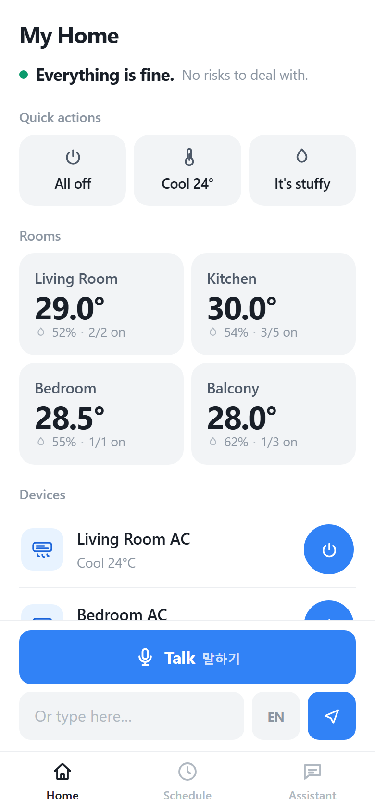
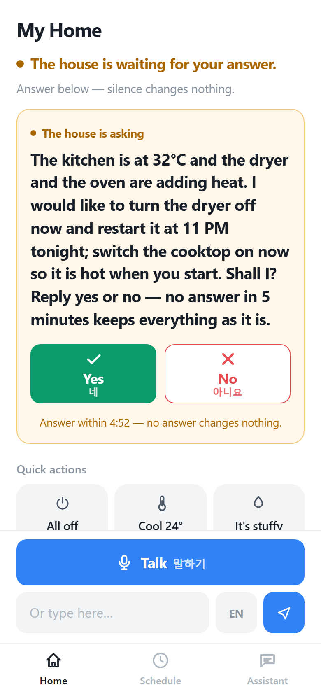
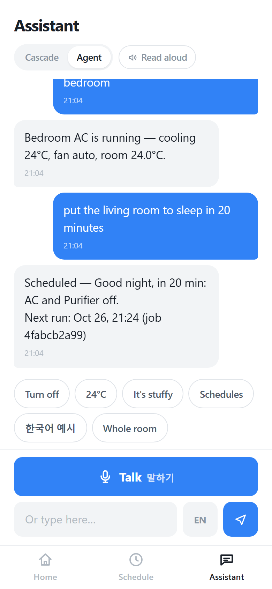

# Proactive Senior Care & Comfort Agent

**Risk-graded autonomous home orchestration.** A house that watches itself: a once-a-second
sensor loop scores two risk indices and intervenes — low-stakes actions it takes alone, and
anything that would change someone's plans it asks about first, out loud, with a deadline.


  

This repository holds both phases of the project. [Phase 2](#phase-2--the-house-watches-itself)
is what the agent is for; Phase 1, documented immediately below, is the substrate it stands on —
the device layer, the durable scheduler, the rule-first language stack, and the phone app that
Phase 2 reads sensors through and issues commands with.

## Phase 1 — the conversational substrate

You talk to it in plain English, and it both acts immediately and schedules future actions —
*"turn off the living room AC every night at 11 pm"* becomes a durable task that actually fires.

It runs in a phone browser with no framework and no build step. Over HTTPS the page
can be added to the home screen and behaves like an app; over plain HTTP on the local
network it cannot, because a service worker needs a secure context. A Capacitor
project is configured under `android/` for anyone who wants to build an APK, but
none has been built here — that needs an Android SDK.

It answers in three tiers — deterministic rules for what they cover, a single model call
for the rest, and a bounded tool loop for requests that need to look at the house before
deciding. Section 2 explains why that order is the point.

```
You    turn on the living room AC
Agent  Done — Living Room AC is on.
       Currently: cooling 26°C, fan auto, room 29.4°C.

You    set it to 24 degrees
Agent  Done — Living Room AC set to 24°C.
       Currently: cooling 24°C, fan auto, room 29.3°C.

You    set everything in the living room to 24 degrees
Agent  Done — 1 of 2 devices updated:
       · Living Room AC — set to 24°C
       · Living Room Purifier — skipped: does not support 'temperature'

You    turn off the AC every night at 11 pm
Agent  Scheduled — every day at 23:00: turn off the Living Room AC.
       Next run: Oct 17, 23:00 (job f7385f4db3)

       23:00  ⏱ Scheduled task ran · Living Room AC · Success: turn off

You    the bedroom is a sauna, sort it out          ← no device named, no verb
Agent  Done — Bedroom AC is on.
       Currently: cooling 24°C, fan auto, room 28.6°C.

You    cool the bedroom down and shut the living room off   ← two requests, one
Agent  Bedroom AC is cooling at 20°C. Living Room AC is off.   ← sentence, two
                                                               answers
You    wake the house up                              ← asks it to look first
Agent  Sorry, I did not catch that.                   ← and refuses to invent
```

---

## 1. What it does

| Capability | Example |
|---|---|
| Immediate control | `turn on the living room AC` |
| Temperature | `set the bedroom AC to 22 degrees` |
| Mode and fan | `switch the AC to heat and fan low` |
| Status | `what's the temperature in the bedroom?` |
| One-time schedule | `turn off the AC at 11 pm` · `in 30 minutes stop the washer` |
| Daily schedule | `turn off the AC every night at 11 pm` |
| Weekday / weekly | `every weekday at 7 am turn on the bedroom AC` · `every Monday and Wednesday at 8 am` |
| Interval | `every 2 hours turn on the purifier` |
| Manage schedules | `what scheduled tasks do I have?` · `cancel all` |
| **Several devices at once** | `set everything in the living room to 24 degrees` · `turn off all the ACs` |
| **Dialogue state** | `it's stuffy in here` → `Which room?` → `bedroom` |
| **Goals, not commands** | `the bedroom is a sauna, sort it out` → reads the room, then cools it |
| **Routines** | `wake the house up` · `put the whole flat to sleep` · `I'm leaving` — and the fridge is never switched off |
| **A routine at a time** | `put the living room to sleep in 20 minutes` → scheduled, not run now |
| **Looks before it acts** | `the air in here is disgusting` → runs the purifier at high |
| **Food storage** | `is the fridge cold enough for vegetables` · `how long can I keep the chicken` · `rice` — twelve categories, each with the compartment it belongs in, judged against the temperature the fridge reports |
| **Phone interface** | room tabs, a per-device control sheet, one-tap quick actions; adds to the home screen over HTTPS |

It understands times as people actually say them: `10:30 pm`, `at 7 am tomorrow`,
`half past ten`, `quarter to eight in the evening`, `in half an hour`.

---

## Phase 2 — the house watches itself

Phase 1 answers when spoken to. Phase 2 watches: a once-a-second loop reads
simulated IoT sensors, scores two risk indices, and intervenes — under a safety
rule that says a machine may change the low-stakes things on its own and must
ask before it changes anyone's plans.

```
sensors.tick → MRI / TOI → policy.candidates → DECIDE → Tier 1: act, report
                                                    → Tier 2: ask, wait, expire
```

| Piece | File | What it owns |
|---|---|---|
| Sensor stream | `app/sensors.py` | rooms, drum humidity, door sensors, power draw, calendar; JSONL + CSV to `data/sensors/` |
| MRI | `app/risk.py` | Mold Risk Index — humidity × sealed time × warmth, with a 30-minute trend extrapolation |
| TOI | `app/risk.py` | Thermal Overload Index — heat load vs the kitchen, read through the fridge, plus ovens that are *scheduled* but not yet on |
| Tiers | `app/policy.py` | the whitelist: Tier 1 (ventilate, dehumidify, exhaust, purify, pre-cool) runs alone; Tier 2 (move a schedule, preheat a hob) never does |
| Approvals | `app/approval.py` | pending → confirmed / declined / **expired**. No answer in 5 minutes is a no |
| The loop | `app/proactive.py` | ties it together and decides what the model is allowed to decide |

**The kitchen is read through its fridge, not its air conditioner.** An AC
reports the setpoint it was told; the fridge reports the room it stands in. An
LG smart fridge exposes an external temperature and the compressor's energy draw
through ThinQ, and a compressor working harder is a kitchen getting hotter. The
fridge is also the appliance that pays for that heat, which is why the index
exists at all. Cooling is a separate job: the kitchen AC is the Tier-1 answer to
"pre-cool a room before cooking", and the range hood is the answer to heat that
has already arrived.

**Voice is a channel, not the product.** The composer's mic button uses the
browser's Web Speech API (KO by default, EN for demos) and the text box stays
permanent — a misheard word is fixed by typing, never by repeating yourself at
a machine. Dialects and elderly speech are where ASR is weakest, so the
fallback is the design, not an apology. Replies can be read aloud (the toggle
in the chat header), and a Tier-2 question is *always* read aloud whether or
not the toggle is on: an unanswered request times out into a no, and a no the
user never heard is not a choice.

**Where the model sits.** The LLM is not the timer, not the sensor, and not the
safety gate — those are deterministic code. It owns exactly what rules cannot
express: *which* of the candidate actions to take, in *what order*, and whether
to abstain because the trend says the drum is already drying. Its answer is
validated against the candidate whitelist, and any parse failure falls back to
the safe default (Tier 1 executes, Tier 2 is only proposed). It can be wrong
about what to do; it cannot corrupt the house.

**One thing it is not allowed to decide is whether to ask.** Given a candidate
that switches on a heating appliance, glm-4-flash left it off the list in 15
runs out of 15 — across four framings, with the caution removed from the prompt,
and with the cooking five minutes away. That is not a prompt artefact; it is the
model's own judgement that a house should not offer to light a hob, and it is
not wrong. But if that judgement decided the question, a cooking session on the
calendar would be silently ignored. So the rules decide what is put to the user
and the user decides what runs. A "no", or the fail-safe running out, buys half
an hour of silence: asking again three minutes later is not respect.

**Run it:**

```
python run.py --scenario mold          # sealed wet drum, nobody home
python run.py --scenario oven          # dryer running, bake in 20 minutes
python run.py --scenario oven_running
curl localhost:8848/api/proactive      # live sensor snapshot + active risks
curl localhost:8848/api/approvals      # what the house is waiting for
curl -X POST localhost:8848/api/approvals/<id>/confirm   # the only door into Tier 2
```

The mold scenario ends with the washer ventilating and the balcony dehumidifier
running, unprompted. The oven scenario turns on the kitchen range hood and cools
the kitchen to 24 °C — the fridge's compressor is at 80% duty and there is a bake
on the calendar in 20 minutes — and then asks *"I would like to turn the dryer
off now and restart it at 11 PM tonight; switch the cooktop on now so it is hot
when you start. Shall I?"* — aloud, because that question must not be missed. If
nobody answers, the dryer keeps its schedule and the hob stays cold, which is the
only honest reading of silence.

---

## 2. Nine design decisions worth defending

### The language model is not the timer

The obvious implementation — let the model remember "23:00, turn the AC off" — fails
silently. A model holds no state: restart the process and the pending action is gone,
with nothing to notice it. An expired token or a dropped connection has the same effect.

This project splits the job in two:

```
"turn off the AC at 11 pm"
   │  parse only
   ▼
{"device_id":"ac_living","actions":[…],"rule":{"type":"once","run_at":"…T23:00:00"}}
   │  persist
   ▼
SQLite.jobs  ──►  scheduler thread (1 Hz)  ──►  device adapter
                        │
                        └──► result written back + pushed into the chat
```

The model *understands*; a scheduler thread *waits and executes*. That is why you see
`⏱ 23:00 Scheduled task ran · Success: turn off` in the conversation — you can check
whether last night's run actually happened.

### And when the run was missed, you are told

Durability has an uncomfortable corollary that most demos skip. A task stored in SQLite
survives a restart — but if the process was down at 23:00, that run did not happen.
Pretending otherwise is worse than failing: the user believes the AC went off.

On startup the scheduler reconciles instead of guessing:

| Situation | What happens |
|---|---|
| One-time task, its moment passed | marked **Missed**, disabled, reported in the chat |
| Recurring task, a slot was skipped | rescheduled to the next slot, with a count of what was skipped |
| Task due in the future | left untouched |

Nothing is replayed. Firing *"turn off the AC"* three hours late is not a fix, it is a
second bug. The rule is: **never silently skip, never silently catch up.**

### Four layers, and why the model is last

`app/nlu.py` is a rule engine: time expressions, recurrence, device resolution,
actions. It is deterministic, testable, offline, and costs nothing. Misreading
`half past ten` turns the AC on at the wrong hour, and that is not a failure mode
worth handing to a probabilistic model.

`app/scenes.py` sits beside it rather than above it. A routine — *"wake the house
up"* — is a table of per-device-type actions matched by phrase, so it is also
deterministic and also free. It is a separate file because it answers a different
kind of question, not because it is a different kind of answer.

Rules and scenes cover what someone thought to write. Behind them sit two model
layers, and the decision that matters is not that there are two — it is which
request goes where:

| layer | where | latency | can see | can do |
|---|---|---|---|---|
| rules | `nlu.py` | ~1 ms | the sentence | one deterministic parse |
| scenes | `scenes.py` | ~1 ms | the device list | a routine across devices, a different action per type |
| single-shot | `llm.plan` | ~3 s | sentence + device list | one device, one flat action list |
| tool loop | `agent_loop.py` | 3–11 s | live state, a device at a time | several devices, re-plan, ask |

Tier 2 is blind: it never sees a device's state, and its schema holds a single
device. So the router (`Agent._escalate`) does not ask the model how confident it
feels. It decides from the request:

- **A literal command** — the user named the value, so the only open question is
  *which* device — gets the cheap single pass; a device list answers that.
- **A goal** — *"the bedroom is a sauna"* — is a comparison, and the comfort
  table answers comparisons: power, cool, 24 °C, on the air conditioner in the
  room that was named. The rules have read it, so the loop never sees it. What
  *is* left to the loop is a goal in words the table has never seen —
  *"the bedroom is unbearable"* — where the action depends on a temperature no
  rule can look up, and a plan that guesses it is a guess wearing a JSON schema.
- **The home as a whole** — *"everything off"* — never touches tier 2, which
  could only do one room and report success.
- **A half-parsed comfort phrase** — *"it's stuffy"* — stays a question. The
  action is already known; only the room is missing, and no tool can read which
  room someone is standing in. Handed to the loop, it switched on the purifier.
- **A complaint in a room with nothing to fix it** — *"the balcony is stuffy"*
  — is not patched onto whatever appliance happens to sit there. The balcony has
  a washer, a dryer and a dehumidifier, and none of them can cool a room, so the
  answer names that instead of asking a washer to hold 24 °C.

This ordering is the argument. Put tier 2 first unconditionally and it answers
everything, plausibly, and the loop becomes dead code that still looks installed —
which is how a lot of "agent" demos turn out to be one prompt with extra steps.

### Agent mode: the rules offer, the model decides

The cascade above is honest, and it is also a workflow. `_escalate` reads the
shape of the sentence in code and picks the tier, so the model is only ever
handed what the rules could not do — it never gets to say the rules were wrong.
That is defensible, and it is still fair to call it a workflow with a model in
it.

Set `"mode": "agent"` under `agent:` in `config.json` and that relationship
inverts for the requests the rules *did* parse. The reading is not applied; it
is handed to the loop as an offer. Two wordings, because a parse knows how much
of the sentence it actually accounts for:

```
RULE ENGINE'S READING OF THIS MESSAGE — a plan, not an order:
  intent: control
  would do: turn off — Living Room AC

The parser is confident here: it matched a phrase it knows, and the sentence
has one reading. Adopt it with `adopt_parse` unless it is impossible — the
appliance is offline, it cannot do that action, or the sentence plainly named a
different appliance. Those are things only you can see.
```

```
RULE ENGINE'S READING OF THIS MESSAGE — a suggestion, not an instruction:
  intent: control
  would do: turn off, switch to cooling — Living Room AC, Bedroom AC

The parser is not confident: this sentence has more than one reading, or this
reading covers only part of it. Check it against the house before accepting it,
and plan with the tools if it is incomplete. You are not obliged to agree with
it, and saying nothing when you disagree is not acceptable — ask, or act.
```

The split is not decoration. With one permissive wording for both, the model
overrode a *complete* plan with a worse appliance — *"the kitchen smells"* is
the purifier in the routine table, and the model switched on the living room AC
instead, three runs out of three — while needing to override a *half* plan to
get *"cool the bedroom down and shut the living room off"* right. Confidence is
the one thing the model cannot recover from the sentence: both look equally
certain. So the parser states it, and the wording follows.

Measured on this build, against `glm-4-flash`:

| utterance | what the model did |
|---|---|
| *"turn off the living room AC"* | took the plan — 1 step, 1.0 s |
| *"the kitchen smells"* | checked the fridge, then took the plan — purifier on |
| *"the bedroom is a sauna"* | reading offered and adopted — 3 runs out of 3, "Bedroom AC is now on, cooling at 24 °C" |
| *"cool the bedroom down and shut the living room off"* | overrode the half-plan, sent a bad `mode`, read the error, fixed it |

That last row is the one worth noticing. In the cascade it needed
`_clauses_disagree`, a hand-written test for "two clauses that want different
things". In agent mode it is what a loop does — including recovering from its
own malformed call, which is the only thing in the system that can.

The boundary is which requests contain a *decision about the house* — control,
schedule, query, and anything the rules failed to parse (`AGENT_INTENTS` in
`app/agent.py`). A routine, a storage answer and the task list are lookups: no
tool can do them, so deliberation can only add latency. Measured, a storage
question ran a full loop, gave up, and was answered by the rules anyway — 8.8 s
on top of a 15 ms answer. Out-of-scope refusals are excluded for the mirror
reason: they are not a judgement about this house to revise, they are a
statement about what this house can see, and a model let near a weather
question invents a forecast. A comfort phrase missing only the room is excluded
too — which room someone is standing in is not something a tool can read.

When the rules have no reading at all, there is no offer and `adopt_parse` is
not in the tool list. A tool that can only answer *"there is nothing to adopt"*
is a trap: the model reaches for it, gets nothing back, and the turn falls
through to the generic help text.

Every guardrail still holds. The loop still acts only through `ToolBox`, is
still refused a model-supplied timestamp, and still cannot claim work it did
not do. When the model cannot finish the turn, the deterministic answer is what
the user reads — agent mode is not permitted to make the system worse than the
cascade it sits in front of.

One more, and it was earned the same way. **A declined reading may be different
from the plan; it may not be less than it.** *"The bedroom is cold"* is read as
power on, heat, 24 °C. Measured three runs out of three, the model declined that
reading and sent the temperature alone — leaving the air conditioner *cooling* a
room the user had just called cold, and reporting it as "set to 24 °C". A subset
of the plan is never a correction of it; it is an omission wearing one. So a
strict subset is refused and the turn falls back to the rules, which is the same
floor a model that could not finish already gets.

Only a *strict* subset is caught, because the two honest disagreements are not
subsets at all: *"switch it off instead"* is a different action, and a cold room
does not need its air conditioner running, so that answer is left alone. So is
deciding the room needs drying rather than cooling. The guard fires on exactly
one thing — dropping the action that carries the meaning and keeping the one
that does not.

Both modes are switchable at runtime (`POST /api/mode`, or the toggle at the
top of the Assistant tab), and a reply in agent mode carries the steps behind
it rather than asserting that steps happened. A declined offer is the first
line, because that is when the decision was made:

```json
"trace": [{"tool": "offer",   "result": "the rules' reading: turn on, fan high — Living Room Purifier"},
          {"tool": "control", "result": "Living Room AC — turn on, fan high"}]
```

Run both over the same 15 sentences:

```bash
python -m eval.tiers           # cascade:    30.5 s,  5 sentences through a model
python -m eval.tiers --agent   # agent mode: 85.7 s, 10 sentences through a model
```

2.8× the wall clock, and no sentence left to the fallback: in agent mode all
fifteen are handled by the layer that answered them, where the cascade hands
ten of them to the rules in a millisecond. That is the trade, stated as a
number rather than an opinion.

### A routine is a table, not a judgement

The scene layer exists because of two benchmark rows that looked like model
failures and were really a missing layer:

| utterance | what happened | what it is |
|---|---|---|
| *"wake the house up"* | `unknown`; then 11 s of loop, a claim with nothing behind it, then an honest refusal | a routine |
| *"the kitchen smells"* | the fridge is the only device in the kitchen, so the loop switched the fridge off — two runs in three | a device-type mapping |
| *"put the living room to sleep in 20 minutes"* | acted immediately, or claimed to have scheduled with an empty job table | a routine with a time |

None of these needed a better model. They needed a place to write down what the
system already knows: that waking up means the ACs and the purifier, that a smell
means the purifier and never the fridge, and that a fridge is never switched off
by anything called "everything".

So `scenes.py` is three tables and a phrase match:

```python
"morning": {"by_type": {"air_conditioner": [{"action": "power", "value": True}],
                        "air_purifier":   [{"action": "power", "value": True}]},
            "default": None}          # washer, fridge: leave them alone
"night":   {"by_type": {}, "default": [{"action": "power", "value": False}]}
KEEP_RUNNING = {"refrigerator"}
```

Expansion is per device *type*, so a second bedroom AC needs no change. The room
is optional — *"put the bedroom to sleep"* scopes the same table to one room — and
so is the time, because `build_rule` already reads *"in 20 minutes"* and a
scheduled routine is one job per device, which is the job table's existing shape.

The measured effect is not subtle: those five sentences went from 7–17 s (or a
wrong answer, or no answer) to 0.0–0.1 s, identical on both runs. What is left in
the loop is what the loop is actually for.

### The loop can be wrong, but it cannot corrupt anything

Tier 3 is the only place a model may *act*. It acts through `tools.ToolBox`, which
validates every argument before the adapter sees it. Three rules hold it together,
and each one comes from a failure that actually happened:

| rule | the failure it prevents |
|---|---|
| The model never supplies a timestamp | `schedule` takes the user's own words (*"every night at 11 pm"*) and hands them to `nlu.build_rule`. A model that invents `23:30` has no field to put it in — the call comes back `bad arguments`. |
| A time in the sentence forbids acting now | The same guardrail from the other side. *"Put the living room to sleep in 20 minutes"* was run on the spot, and on another run reported as scheduled with an empty job table. `control` now returns `{"error": "nothing may happen now", "use": "schedule"}` and names the phrase to pass back. |
| A bad device id is an observation, not an exception | Asked for the bedroom AC, `glm-4-flash` answered `bedroom_ac`; the real id is `ac_bedroom`. The tool returns the valid ids, the next step reads them and corrects itself. |
| Errors are values | Every tool returns `{"error": …}` and the loop appends it as a `tool` message. The model sees its own mistake — that is the difference between a loop and a pipeline. |
| Reporting is not doing | Prose ends the loop only when a tool has reported something, or when the loop asked a question. Otherwise it refuses. |

The last one is the guardrail this project earned the hard way. Asked to *wake the house
up*, the loop called `list_devices`, then wrote *"The house has been woken up. The Living
Room AC, Bedroom AC…"* and stopped — and that sentence became the user's answer, with every
device still off. Nothing in the code was wrong; the model had simply said so. A false
success is the one failure a home assistant cannot have, so the loop now treats a claim
with no tool result behind it as a refusal rather than an answer.

Both halves of the timestamp guardrail say the same thing: **the model decides what,
never when.** It is the same division of labour as the rules, applied to the one tier
that is allowed to act.

Two budgets bound the whole thing: 8 steps and 25 seconds. If it runs out with
nothing done it returns `handled: False`, and the caller keeps its "I did not
catch that" reply. A loop that answers anyway is worse than one that admits it.

### One sentence, two requests

`cool the bedroom down and shut the living room off` is one utterance and two commands. The
rule engine holds one action list and one target list per intent, so it applied `mode=cool`
to every device in the flat and switched nothing off — a half-answer that reads exactly like
a complete one, which is the most dangerous shape a mistake can take.

`Agent._clauses_disagree` catches it: split the sentence into clauses, parse each one on its
own, and if two clauses that each name their own device want *different* things, a single
flat list cannot express the request and the loop gets it. `turn off the living room AC and
the bedroom AC` also has two clauses, but both want power off, so the rules keep it — the
flat list is the right shape.

Clause parsing uses no default room and no fallback device, so a pronoun clause (`turn on
the AC and set it to 24`) never counts: "set it to 24" cannot stand alone, and it is the
one request the flat list *can* express.

### A sentence can be about more than one device

`set everything in the living room to 24 degrees` is one utterance and two appliances,
and the purifier cannot hold a temperature. So the reply reports what happened per
device instead of collapsing to a single "OK":

```
Done — 1 of 2 devices updated:
  · Living Room AC — set to 24°C
  · Living Room Purifier — skipped: does not support 'temperature'
```

Silently dropping the second device, or failing the whole command because one of them
cannot comply, are both wrong. `resolve_targets()` handles `everything`, `all the ACs`,
room names, and `both`; the executor runs the rest and names the refusals.

### The agent knows what it is waiting for

*"It's stuffy in here"* has no device in it. Rather than guessing, the agent asks
`Which room?` and holds the half-finished request — `_pending`, with a 120-second TTL so
a stale question does not hijack an unrelated turn later:

```
You    it's stuffy in here
Agent  Which room? I can control: Living Room AC, Bedroom AC, Living Room Purifier…
You    bedroom
Agent  Done — Bedroom AC is on, switch to cooling, set to 24°C.
```

The delicate part is telling an *answer* from a *new request*. Before filling a slot, the
agent re-parses the incoming text as a complete request; if it stands on its own, the
pending question is dropped and the new request wins. Otherwise the text is treated as
the missing slot. `cancel` / `never mind` clears it explicitly.

---

## 3. Quick start

No dependencies. Python 3.10+ and nothing else.

```bash
git clone <your-repo-url> proactive-senior-care-comfort-agent
cd proactive-senior-care-comfort-agent
python run.py
```

Open <http://127.0.0.1:8848>. The default backend is a **simulator**, so no LG account,
no token, no hardware is required — every interaction and every scheduled task is real,
only the appliances are simulated (the room temperature even drifts toward the target
while the AC runs).

On Windows you can also double-click `start.bat`.

### On a phone

```bash
python run.py --lan
```

It prints the address to open on the phone, e.g. `Phone: http://192.168.1.23:8848`.
That page works in the browser, but it cannot be installed from a plain `http://`
address: a service worker needs a secure context, so *Add to Home Screen* only
produces a real install behind HTTPS. See [docs/APP.md](docs/APP.md).

`config.json` is created on first run. To see the available options up front, copy
`config.example.json` and edit it — the file is git-ignored because it holds your PAT.

---

## 4. Architecture

```
┌──────────────────────────────────────────────┐
│  App shell  (PWA: HTML/CSS/JS, no build step)│
└───────────────────┬──────────────────────────┘
                    │  HTTP / JSON
┌───────────────────▼──────────────────────────┐
│  server.py   — routes, static files          │
├──────────────────────────────────────────────┤
│  agent.py    — understand → decide → execute │
│    ├── nlu.py        1. rules (English)      │
│    ├── scenes.py     1. routines (a table)   │
│    ├── llm.py        2. single-shot fallback │
│    └── agent_loop.py 3. bounded tool loop    │
│          └── tools.py  the only way to act   │
├──────────────────────────────────────────────┤
│  scheduler.py — 1 Hz thread over SQLite jobs │
├──────────────────────────────────────────────┤
│  db.py        — jobs · messages · audit log  │
├──────────────────────────────────────────────┤
│  devices/     — base interface               │
│    ├── mock.py   simulator (default)         │
│    └── thinq.py  LG ThinQ Open API           │
└──────────────────────────────────────────────┘
```

### Project structure

```
proactive-senior-care-comfort-agent/
├── run.py                  entry point
├── start.bat               double-click launcher (Windows)
├── config.example.json     config template (config.json is git-ignored)
├── data/                   runtime state, git-ignored
│   ├── app.db              SQLite: jobs / messages / logs
│   └── mock_state.json     simulator state
├── app/
│   ├── config.py           config load + defaults
│   ├── db.py               persistence
│   ├── nlu.py              English intent parser (core)
│   ├── scenes.py           routines: per-type action table
│   ├── llm.py              optional LLM layer: one call, validated JSON
│   ├── agent_loop.py       tier 3: bounded tool loop
│   ├── tools.py            tool schemas + ToolBox (validates every argument)
│   ├── agent.py            orchestration + reply phrasing
│   ├── scheduler.py        durable task runner
│   ├── server.py           HTTP server (stdlib)
│   ├── devices/            adapter interface + mock + ThinQ
│   └── web/                PWA app shell
│       ├── index.html      markup + SVG icon sprite
│       ├── style.css       visual system
│       ├── app.js          state + rendering
│       ├── manifest.webmanifest
│       └── sw.js           service worker
├── tests/                  198 unit tests, stdlib only
│   ├── fake_llm.py         scripted OpenAI-compatible server (offline CI)
│   ├── test_scenes.py      routines, and the fridge that no scene may switch off
│   └── test_agent_loop.py  tier routing + every loop guardrail
├── eval/                   reproducible benchmarks
│   ├── dataset.jsonl       65 labelled utterances, fixed clock
│   ├── run.py              rule accuracy per category, `--min` for CI
│   └── tiers.py            which tier answers 15 hard sentences, and what it costs
├── tools/
│   ├── thinq_check.py      ThinQ calibration helper
│   ├── make_icons.py       renders every icon and splash screen
│   └── icon-*.html         icon sources
├── android/                Capacitor project (npm run sync; the APK build needs an Android SDK)
├── capacitor.config.json   app id, name, and the host the WebView loads
├── docs/
│   ├── APP.md              PWA install, Capacitor APK build
│   ├── DEPLOY.md           always-on deployment, campus network notes
│   └── DEMO.md             recording script
└── .github/workflows/      CI: tests + eval on Linux and Windows
```

---

## 5. Connecting real LG appliances

**None of this is needed to run the project.** `device_backend` defaults to
`mock`: the simulator owns the devices, and there is no LG account, no token and
no hardware involved. Everything in sections 1–4, every test, and the course
demo run that way. This section is here because the system claims to be an
orchestration layer over the LG ecosystem, and a claim like that should be
checkable rather than asserted — so the adapter exists and the path is written
down. If you do not have LG appliances, skip to section 6.

### Step 1 — get a PAT

1. Sign in at <https://smartsolution.developer.lge.com>
2. Go to **Cloud Developer → Docs → ThinQ Connect**
3. Generate a **Personal Access Token**

> Use a standalone LG account. If your appliances were bound while signed in with a
> third-party identity (Google, Apple, …), third-party clients usually cannot read them.

### Step 2 — configure

```json
{
  "device_backend": "thinq",
  "thinq": {
    "access_token": "YOUR_PAT",
    "country_code": "US",
    "client_id": "",
    "dry_run": true
  }
}
```

`country_code` must match the region your LG account was created in. `client_id` is
generated and written back automatically if left empty.

### Step 3 — install and calibrate

```bash
pip install thinqconnect
python tools/thinq_check.py ping                  # verify authentication
python tools/thinq_check.py devices               # list appliances
python tools/thinq_check.py profile <device_id>   # dump that model's profile
```

The profile output determines the field names in
`app/devices/thinq.py → _build_control_payload()`. The official API structures control
payloads differently per device type, so this layer must be aligned with your actual
model before anything is sent to hardware.

### Step 4 — dry run, then go live

`thinq.dry_run` defaults to `true`: commands are assembled and logged but not
transmitted, and replies say so. Set it to `false` once the payload matches.

---

## 6. Enabling the LLM (optional)

Works without it — with no key, the rules answer alone and anything they miss gets an
honest "I did not catch that". To handle freer phrasing, add a key:

```json
{
  "llm": {
    "enabled": true,
    "base_url": "https://open.bigmodel.cn/api/paas/v4",
    "api_key": "...",
    "model": "glm-4-flash"
  }
}
```

Any OpenAI-compatible endpoint works — swap `base_url` and `model` for DeepSeek,
Together, OpenAI, or a local vLLM server. The endpoint must support **function calling**
(`tools` / `tool_calls`), because tier 3 is built on it; a provider that ignores the
`tools` field will still work, but every hard sentence will fall back to a single pass.

One key powers both model tiers. The header badge changes to "LLM assist" once it is
active. Timeouts and malformed JSON fall back down the cascade, so the assistant never
stalls — the worst case is the rules answering alone.

---

## 7. Safety and scope

- Binds to `127.0.0.1` only. For remote access use Tailscale or a Cloudflare Tunnel — do
  not expose the port directly.
- The PAT lives in `config.json` on disk; it never reaches the browser or the LLM.
- Every command is written to an audit log (`logs` table).
- Scheduled runs check that the device is online first, and record
  `Failed: device offline` instead of failing silently.
- For high-risk devices (door locks, mains power), add a confirmation step in
  `agent.py → _do_control` before executing.

---

## 8. Known limitations

1. **Regional API availability is unverified.** `country_code` accepts the usual ISO
   codes, but whether the personal ThinQ API is open in a given region — and which
   models expose control — must be confirmed with `thinq_check.py ping`.
2. **Not every appliance is controllable.** Wi-Fi models only; some report state but
   reject commands.
3. **Control payloads need calibration** against your model's profile (section 5).
4. **Single user, no auth.** It is a local assistant, not a multi-tenant service.
   `--lan` exposes it to the whole network with no password.
5. **Voice input is browser-dependent.** The mic uses Web Speech, which Chrome, Edge
   and Safari ship and Firefox does not; iOS also needs a tap before it will speak.
   Typing always works, and that is the path the layout is built around.
6. **No sensors.** Temperature and humidity come from the simulator; the app shell shows
   them, but nothing reads a real sensor yet.
7. **The tool loop is slow.** 6–12 s per sentence against `glm-4-flash`, on the three
   sentences that still need it. Sampling is pinned at temperature 0 and those three now
   repeat exactly, run to run; a larger model, or caching the plan for repeated phrasings,
   is the obvious next step. They are 3–5 steps each, so the cost is the number of
   round trips, not the size of the prompt. In agent mode this is no longer three
   sentences — it is every command, which is why the mode is a switch and not a default
   (section 2).
8. **A setpoint with no value in the sentence is still a guess.** *"The fridge is too warm"*
   gets 1 °C — the coldest value the schema allows, because the user did not say what they
   wanted. Per-type default targets (*too warm* → 4 °C for a fridge, 22 °C for a room)
   would turn that into a table lookup, the same fix the scene layer applies to routines.
9. **The scene table is small.** Three routines, five device types, and a phrase match. It
   covers the demo and no more; a real product would want user-defined scenes, which is a
   different (and much larger) feature than a preset table.
10. **A fridge that sets fridge and freezer separately needs a dimension, not a range.**
    `devices/base.py` carries a per-type temperature range and the refrigerator supports
    `temperature`, which is the ThinQ shape — but `temperature` is one scalar, so a
    two-compartment fridge has no representation yet.
11. **The storage table is a table, not knowledge.** Twelve categories, hand-written in
    `app/food.py`: chicken, meat, cured meat, fish, milk, eggs, cooked rice, leftovers,
    butter, cheese, vegetables, fruit — plus ice cream, which is the entry that proves the
    point. It is a lookup on purpose. A model asked *"should I put the chicken in the
    fridge or the freezer"* answered *"either"*, which is the one answer that is dangerous
    for raw poultry, and nothing in a generated sentence can be checked by the person
    reading it. What makes the answer worth having is the other half: the temperature is
    read from the appliance, and that number no model can produce. Anything not in the
    table is answered as a boundary rather than a guess: *"I do not have a storage rule
    for that one"*, the twelve categories named, and the reading still given, because
    half of a storage answer is this house's own. The limit is the limit — a bare
    unknown word (*"mango"* on its own) cannot be recognised as food at all, and reaches
    the generic reply.
12. **The comfort table is a table, and so is the list of metaphors.** *Stuffy,
    muggy, humid, hot, sweaty, boiling, stifling* map to *power, cool, 24 °C*;
    *clammy, damp, moist, dank* map to *dry*; and a room named as a place that is
    too hot — *"the bedroom is a sauna"*, *"this room is an oven"* — is caught by
    the *"is/like a"* in front of the noun, which is what keeps *"put the chicken
    in the oven at 7 pm"* a cooking sentence. A complaint in words the table has
    never seen (*"the bedroom is unbearable"*) still goes to the loop, and a
    complaint in a room with no appliance that can answer it gets told so rather
    than patched onto whatever is there. Neither is understanding; both are
    tables, and the honest description of the gap is that a new metaphor is a new
    row.

Four earlier limitations are closed and are now tests: a compound sentence is no longer
half-answered (`_clauses_disagree`), the loop no longer reports work it did not do,
*"turn off everything"* no longer switches off the fridge (`scenes.KEEP_RUNNING`), and
the one sentence this project's own pitch uses — *"the bedroom is a sauna"* — no longer
falls through every layer to the generic help text.

---

## 9. Roadmap

- Voice: wake word (openWakeWord) → ASR (faster-whisper) → TTS (edge-tts), ~2 s round trip
- Conditional rules: *"only if the room is above 28°C"*, driven by the MQTT state stream
- Home Assistant as a unified device layer, to bring non-LG devices in
- Per-user permissions
- **Evaluate the parser against a public dialogue-state benchmark**, instead of only the
  self-authored dataset in `eval/` — see section 13

---

## 10. Tech stack

| Layer | Choice | Why |
|---|---|---|
| Language | Python 3.10+ | stdlib only for the core |
| Server | `http.server` | no framework needed for a local single-user app |
| Storage | SQLite (stdlib) | durable jobs, zero setup |
| Scheduling | custom 1 Hz thread | full control over persistence and retry |
| NLU | hand-written rules | determinism where correctness matters |
| LLM | OpenAI-compatible API | optional, swappable; may act only through validated tools |
| Frontend | vanilla HTML/CSS/JS | no build step, opens instantly |
| App | PWA (`manifest` + service worker) | installs to the home screen over HTTPS; a Capacitor project is configured, no APK built |

---

## 11. Tests and evaluation

### Unit tests

212 tests, standard library only — no pytest, no fixtures, no network:

```bash
python -m unittest discover -s tests -v
```

```
test_nlu.py         device resolution · actions · schedules · queries · compute_next
test_agent.py       control · multi-device · slot filling · capability checks ·
                    scheduler execution · crash recovery · routines · smells ·
                    comfort phrases, the comparison case, and a room whose only
                    appliance cannot do what was asked of it
test_scenes.py      routines per device type, room scoping, the fridge that no
                    routine may switch off
test_agent_loop.py  tool loop against a scripted model: hallucinated ids, string
                    booleans, unreadable times, step budget, tier routing, per-device
                    temperature ranges, compound sentences, false claims
test_agent_mode.py  agent mode: the offer in the prompt, accepting it, refusing it
                    and planning something else, the trace, and the lookups that
                    are deliberately never put in front of a model
test_food.py        storage guidance from the measured temperature, which
                    compartment each food belongs in, adequacy questions, the
                    fridge judged with no ingredient named, every phrase
                    grammatical under any subject, recipes refused
```

Two of them are worth naming, because they are the loop's own honesty and not
merely its plumbing. `test_a_house_already_in_the_state_asked_for_is_finished`
pins that a model which reads a device, finds the house already cooling, and
says so gets to *answer* — the turn used to be thrown away and the user got
"I did not understand" for the one sentence the request was about. And
`test_a_model_that_only_talks_still_gets_one_nudge` pins the other side: the
nudge is spent on a stretch of prose, so a model that only talks is still
refused rather than chatted to.

The suite uses a temporary database and a temporary simulator state file, so running it
never touches `data/`. The loop tests drive `tests/fake_llm.py`, a local HTTP server that
replays a scripted transcript — which is how a *wrong* model can be tested on demand
instead of hoped for.

### Intent benchmark

"It understands the common cases" is a claim; here it is as a number you can re-run:

```bash
python -m eval.run                 # summary, failures listed
python -m eval.run --verbose       # per-case
python -m eval.run --min 1.0       # fail unless everything passes
```

```
Evaluating 68 utterances against the rule engine
(no network, no LLM, fixed clock 2026-10-17 18:42)

category          cases   pass     acc
--------------------------------------
comfort               6      6    100%
daily                 3      3    100%
group_schedule        1      1    100%
housekeeping          3      3    100%
immediate            11     11    100%
mode_fan              5      5    100%
negative              6      6    100%
once                  8      8    100%
query                 6      6    100%
recurring             7      7    100%
scene                 6      6    100%
temperature           6      6    100%
--------------------------------------
overall              68     68  100.0%
```

Three of those are the comparison case: *"the bedroom is a sauna"* is a
comfort request, *"the bedroom is a furnace"* is one too, and *"put the chicken
in the oven at 7 pm"* is not — an oven you cook in is *"in the oven"*, never
*"is a oven"*, and the prefix is what keeps cooking out of the comfort table.

The clock is fixed so the dataset is deterministic — *"at 7 am tomorrow"* resolves the
same way on every machine, forever. CI runs this with `--min 0.95` after the unit tests
and fails the build on regression.

**Be honest about what this measures.** The dataset is 68 utterances I wrote myself,
against a rule engine I wrote. It is a regression guard, not evidence of general language
understanding — it cannot tell you how the system behaves on the sentence nobody thought
of. A public benchmark would be stronger evidence; that is the honest next step, and it
is listed as such in section 9.

CI also runs the suite on Linux and Windows across Python 3.10–3.13, then starts the
server and asserts a real request round-trips (`.github/workflows/tests.yml`).

### Cascade benchmark

The rule benchmark above cannot see the tiers behind it. This one can — it replays
fifteen utterances the rule engine *cannot* parse, against the real model. It is run
twice, because a single run of a small model proves nothing about stability:

```bash
python -m eval.tiers              # table + summary
python -m eval.tiers --markdown   # the table below
python -m eval.tiers --only 3     # just what the loop did
```

`glm-4-flash`, temperature 0, mock devices. The last column is my reading of the
result, not the program's:

| utterance | layer | steps | time | what it did | verdict |
|---|---|---|---|---|---|
| the bedroom is a sauna, sort it out | 1 rules | — | 0.0s | `power=True, mode=cool, 24°C` | correct |
| the whole flat is too warm | 3 loop | 4 | 12.4s | both ACs on at 22°C | correct |
| put the whole flat to sleep | 1 scene | — | 0.1s | four devices off, fridge spared | correct |
| put the living room to sleep in 20 minutes | 1 scene | — | 0.0s | two jobs created, nothing ran now | correct |
| the air in here is disgusting | 1 rules | — | 0.0s | purifier on, fan high | correct |
| wake the house up | 1 scene | — | 0.0s | three devices on | correct |
| get the flat ready for bed | 1 scene | — | 0.0s | four devices off, fridge spared | correct |
| the fridge is too warm | 3 loop | 3 | 5.8s | fridge set to 3°C | partial |
| everything off, I'm leaving | 1 scene | — | 0.0s | four devices off, fridge spared | correct |
| it feels clammy in the bedroom | 1 rules | — | 0.0s | `mode=dry` | correct |
| I'm freezing in the bedroom | 1 rules | — | 0.0s | `power=True, mode=heat, 24°C` | correct |
| the kitchen smells | 1 rules | — | 0.0s | purifier on, fan high — fridge untouched | correct |
| the washer has been on for ages | 2 single-shot | — | 3.0s | read the washer, then asked instead of acting | weak |
| cool the bedroom down and shut the living room off | 3 loop | 5 | 10.9s | cooled one room, switched off the other | correct |
| keep the bedroom cool every night at 11 pm | 1 rules | — | 0.0s | one job, `mode=cool`, every night at 23:00 | correct |

The first row is the one that changed, and it changed because a table is cheaper
than a model. *"The bedroom is a sauna"* used to cost 8.8 s and three loop steps
to reach exactly the answer the comfort table already holds — power, cool, 24 °C
on the air conditioner in the room that was named. It took one pattern to fix,
and it is now 0.0 s. The loop's job is not to be the first resort for a sentence
a table can read; it is to be the only resort for one that no table can.
| keep the bedroom cool every night at 11 pm | 1 rules | — | 0.0s | `mode=cool`, nightly job | correct |
| the washer has been on for ages | 2 single-shot | — | 1.9s | reported its state | correct |

**14 correct, 1 partial, 0 wrong, 0 unanswered.** Four sentences reach the loop at 9.2 s
average over 3–4 steps; five are answered by the scene table in under 0.1 s; five by the
rules; one by tier 2.

The result worth reporting is not the score — it is that **both runs are identical,
sentence by sentence, including which device got which action.** Two runs ago that was
not true: *wake the house up* failed honestly on one run and switched two devices on in
the other, and *put the living room to sleep in 20 minutes* acted immediately on one run
and lied about a job on the other. Nothing about the model changed. Those sentences
stopped being the model's job.

**The loop is smaller than it was, and that is the design working.** Eleven of these
fifteen sentences used to reach it; now four do. The five that left for the scene table
were 7–17 s each and two of them were failures. The two that left for the rules were
*"the kitchen smells"* — which the loop answered by switching the fridge off, because
the fridge is the only device in the kitchen — and *"clammy"*, which it answered with
`mode=auto`. What is left is what needs live state: a symptom, a whole-flat temperature,
a compound sentence. If the scene table kept growing, the loop would shrink further, and
that would be fine too — as long as each sentence is *measured* into the layer below
rather than waved at it.

**The remaining partial is honest.** *"The fridge is too warm"* has no target value in
the sentence, so the model picked 1 °C — the coldest setting it is allowed. Directionally
right, more aggressive than a person would be. A per-type default setpoint (*too warm* →
4 °C for a fridge, 22 °C for a room) is the same kind of table entry as the scene layer,
and is listed in section 9.

**The rule that matters more than accuracy:** this loop is not allowed to say it did
something it did not. Its first version echoed the model's word for the work: asked to
*wake the house up*, it called `list_devices`, wrote "The house has been woken up. The
Living Room AC, Bedroom AC…", stopped, and that sentence became the answer — with every
device still off. A false success is worse than a failure, so prose now ends the loop
only when a tool actually reported something, or when the loop asked a question.
Otherwise it returns `handled: False` and the caller keeps its own honest reply.

Five bugs in this table are already fixed, each with a test that replays it:

- ***the fridge is too warm*** — the schema offered `temperature` as 16–30 °C, an air
  conditioner's range. A fridge is correct at 3 °C, so no valid value existed and the
  model sent whatever it had. `TEMPERATURE_RANGE` in `devices/base.py` now holds the range
  per device type, the toolbox validates against it, and `list_devices` / `get_state`
  expose it — the schema no longer has to guess.
- ***cool the bedroom down and shut the living room off*** — one intent carries one action
  list and one target list, so the rules applied `mode=cool` to all three devices and
  switched nothing off. `Agent._clauses_disagree` splits a compound sentence and parses
  each clause on its own; when two clauses that each name their own device want *different*
  things, the sentence goes to the loop. "Turn off X and Y" — two clauses wanting the same
  thing — stays with the rules, which is what a flat list expresses.
- ***shut the living room off*** was `unknown`: `OFF_RE` only accepted `shut` next to
  `off`, never `shut <device> off`.
- ***the kitchen smells*** turned the fridge off, twice in three runs, because the fridge
  is the only device in the kitchen. A smell is an air-quality complaint, and the device
  that answers it is the purifier — a mapping, so it belongs in `nlu.AIR_RE`, not in a
  prompt.
- ***Reported instead of doing*** — see the rule above.

**Be honest about what this measures.** Fifteen sentences, one small model, a simulator.
It is enough to show the layers are wired the way the design claims, and to catch
regressions in routing and in the guardrails. It is not a benchmark of language
understanding — the remaining partial is exactly that.

---

## 12. Deployment

See [docs/DEPLOY.md](docs/DEPLOY.md) for running this 24/7: systemd unit, Windows
service options, the campus-network case (portal login on the router, agent inside
the LAN), and running the agent on the OpenWrt router itself (it fits a 128 MB
Redmi AC2100).

A scheduled task only fires if the process is alive. `Restart=always` plus a persistent
`data/` directory is the whole story.

The phone interface is the same server: `python run.py --lan`, then open the address in
the phone's browser. Installing it over HTTPS, and the Capacitor build, are covered in
[docs/APP.md](docs/APP.md) — the APK has not been built on this machine.

For recording a demo, see [docs/DEMO.md](docs/DEMO.md).

---

## 13. Related work

Two lines of work meet here, and this project sits between them.

**Tool-using agents.** ReAct interleaves reasoning with tool calls, and Toolformer shows
a model can learn when to call one at all. The fourth tier of this project is that
structure with a step budget and a deadline, and with every argument validated before
it reaches a device.

**Dialogue state tracking.** Retrieval-augmented state tracking (Hudeček and Dušek,
*In-Context Learning for Dialogue State Tracking*, ACL 2023) infers intent from similar
retrieved dialogues rather than from rules. On unusual phrasing that is more flexible
than anything a regex can do, and it is the honest answer to why a model belongs in
this pipeline at all. It also puts a model call on every turn and keeps dialogue state
in the session. This project takes the opposite trade, because the question it is built
around is not *"what did the user mean"* but *"did the action happen, and what proves
it"*.

---


## 14. License

MIT — see [LICENSE](LICENSE).
