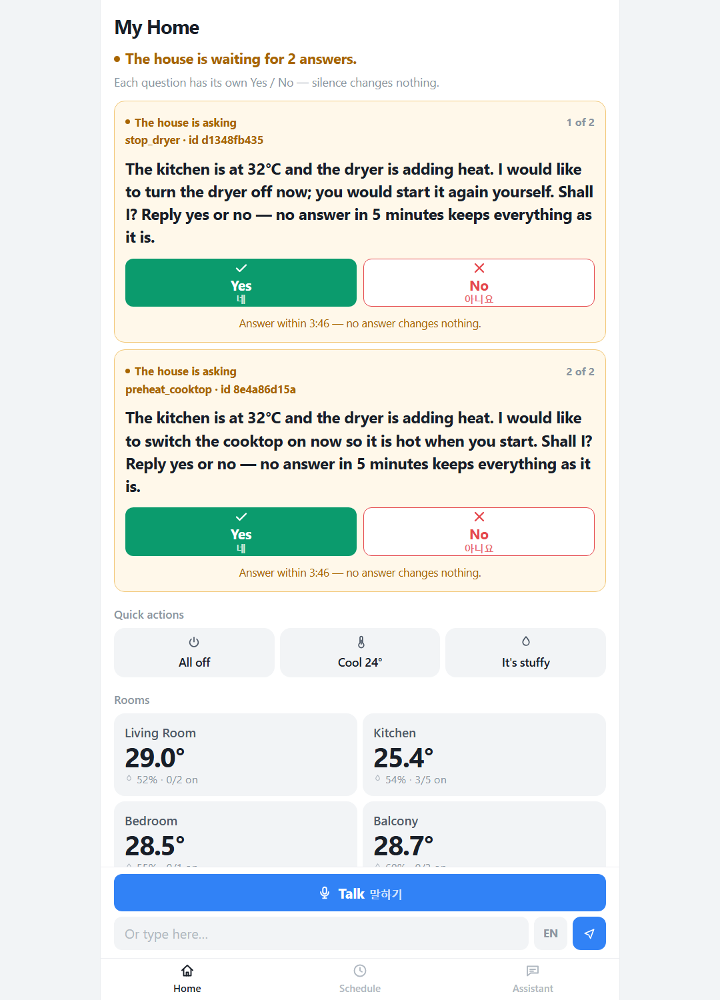
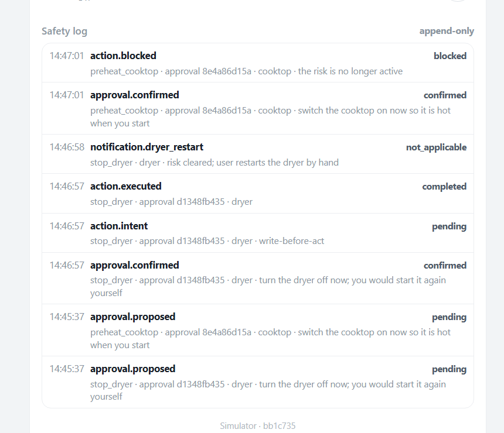

# Proactive Senior Care & Comfort Agent

**Risk-graded autonomous home orchestration for safer, more comfortable living.**

A house that watches itself: a once-a-second loop over simulated sensors scores
two risk indices, then acts under a two-level safety policy. Low-stakes,
reversible actions run on their own. Anything that changes what the user planned
waits for an explicit answer, with a deadline.


Built for CSE406 Term Project III, Phase 2 (Specification). Sensor readings and
appliances are **simulated**: the prototype runs locally without physical LG
hardware and without an API key.



---

## Phase 2 core behaviour

The loop is `sensors at 1 Hz → risk evaluation → safety policy → act or ask`.
Two deterministic indices, both scored 0–100 and both triggering at 50.0:

- **MRI (Mold Risk Index)** — humidity trapped in a sealed washer drum, scored
  from drum humidity, how long it has been sealed, room temperature and the
  recent humidity trend.
- **TOI (Thermal Overload Index)** — kitchen heat load, scored from appliance
  wattage, kitchen temperature, refrigerator compressor duty cycle and a
  cooking session scheduled within the next 30 minutes.

**Level 1** runs automatically and is logged and reported. Every **Level 2**
action is presented as its own approval request; only an explicit confirmation
of that request executes that action.
An optional language model may rank Level 1 candidates, but it cannot add an
action outside the whitelist, approve a Level 2 action, or replace the rules —
if the model is unavailable or returns unusable output, the rules decide.

### Action whitelist (7 actions)

| Level | Action | Device |
|---|---|---|
| 1 | `ventilate_washer` | Washer drum vent |
| 1 | `dehumidifier_on` | Balcony dehumidifier |
| 1 | `purifier_on` | Living-room purifier |
| 1 | `ventilate_kitchen` | Kitchen range hood |
| 1 | `precool_kitchen` | Kitchen air conditioner |
| 2 | `stop_dryer` | Dryer |
| 2 | `preheat_cooktop` | Cooktop |

Each Level 2 action gets its **own approval request** — its own
`approval_id`, question, Yes / No buttons and deadline. Approving one can never
authorise another. Requests expire after **300 s**; declining one, or letting
it expire, leaves that appliance unchanged and starts a **30-minute** quiet
period for that risk.

Before a confirmed action reaches a device, the engine re-checks the approval,
the live risk, the device state and the safety interlocks against a fresh
sensor snapshot. If they no longer hold, the action is refused with a visible
reason and an `action.blocked` row. Preheating the cooktop additionally needs
`user_home` and switches itself off if no cooking starts or its maximum run
time is reached. Stopping the dryer leaves it off: once the risk clears, the
house sends one reminder and the user restarts it by hand — it is never
restarted automatically.

### Append-only safety log

`app/audit.py` is the single gate for every device change. The intent is
written **before** the adapter is called and the outcome immediately after;
if the intent cannot be persisted, nothing moves. `app/db.py` protects
`audit_log` with `BEFORE UPDATE` / `BEFORE DELETE` triggers, so rows cannot be
rewritten or removed by application code. `GET /api/audit` and the on-screen
Safety log show the same rows, linked by `approval_id`.



---

## Architecture

```text
Simulated sensors (1 Hz)
        |
        v
MRI / TOI risk evaluation         app/risk.py
        |
        v
Safety policy + action whitelist  app/policy.py
        |
        +--> Level 1: execute, log, report
        |
        +--> Level 2: ask -> revalidate -> confirm or expire   app/approval.py
        |
        v
Append-only audit_log: intent -> adapter -> outcome       app/audit.py
        |
        v
SQLite messages / logs + web status
```

| Directory | File | Module / responsibility |
|---|---|---|
| `app/` | `sensors.py` | 1 Hz simulated environmental and appliance telemetry |
| `app/` | `risk.py` | MRI and TOI evaluation |
| `app/` | `policy.py` | Seven-action whitelist and the two action levels |
| `app/` | `approval.py` | Per-action pending, confirmed, declined and expired requests |
| `app/` | `proactive.py` | Observe–decide–act loop, revalidation, safeguards, system messages |
| `app/` | `audit.py` | Write-before-act gate and append-only audit events |
| `app/web/` | `index.html`, `app.js` | Approval queue, Safety log, device state, controls |
| `app/` | `db.py` | SQLite schedules, messages, immutable audit log |
| — | `run.py` | Entry point and demo scenarios |

---

## Quick start

Python 3.10 or later. The core has **no third-party runtime dependencies**.

```bash
git clone https://github.com/tbrobo99/proactive-senior-care-comfort-agent.git
cd proactive-senior-care-comfort-agent
python run.py
```

Open <http://127.0.0.1:8848>. On Windows, `start.bat` also works. To open the
same page from a phone on the local network, use `python run.py --lan`.

---

## Demo / use cases

### Use case 1 — mold risk

```bash
python run.py --scenario mold
```

MRI crosses its threshold; Level 1 actions such as washer ventilation and
dehumidification run automatically, and the interface explains what happened.

### Use case 2 — thermal overload

```bash
python run.py --scenario oven
```

TOI detects the upcoming cooking session and concurrent appliance load.
Level 1 cooling or ventilation runs automatically; the two Level 2 actions
appear as **two separate cards**, each with its own `approval_id`. Answering
one leaves the other pending. Because the first Yes can already clear the
risk, a second Yes may be refused by pre-execution revalidation — that is the
fail-safe working, and it is written to the safety log as `action.blocked`.
Declining, ignoring, or answering after the deadline never executes them.

Useful endpoints:

```bash
curl http://127.0.0.1:8848/api/proactive
curl http://127.0.0.1:8848/api/approvals
curl http://127.0.0.1:8848/api/audit
curl http://127.0.0.1:8848/api/logs
```

### Fully offline run (recommended for a recorded walkthrough)

Point the model at a dead port and the whole loop still completes on rules:

```bash
# macOS / Linux / Git Bash
LLM_BASE_URL=http://127.0.0.1:9 python run.py --no-browser --scenario oven
```

```powershell
# Windows PowerShell
$env:LLM_BASE_URL="http://127.0.0.1:9"; python run.py --no-browser --scenario oven
```

`/api/logs` then records `proactive.decide_fallback` — the model was
unreachable and the rules took the default — while the approval cards, Level 1
actions and confirmation all behave normally. Set `DATA_DIR` to keep the
database, device states and audit log out of the working tree; a fresh
directory starts from clean device defaults.

---

## Tests

```bash
python -m unittest discover -s tests -v
python -m eval.run
python -m eval.latency
```

The unit suite covers the risk indices, the seven-action whitelist, per-action
approvals, pre-execution revalidation, cooktop safeguards and the append-only
audit trail. `eval.run` is the intent-parser regression suite. `eval.latency`
measures the local check and the model-backed decision separately; **without
an LLM key only the local check half is measured**. GitHub Actions runs the
unit tests and `eval.run` on Windows and Linux with Python 3.10, 3.12 and 3.13.

---

## Options and scope

- **Optional LLM:** copy `config.example.json` to `config.json` and fill in the
  `llm` section. The model never owns sensor timing, risk calculation,
  approval or device safety.
- **Optional LG ThinQ adapter:** `app/devices/thinq.py`, with `dry_run` enabled
  by default. Real-device control needs the optional `thinqconnect` SDK and
  payload calibration per appliance model.
- **Scope:** simulated sensors and appliances for the course demonstration;
  local, single-user environment; voice input needs browser speech support,
  typing remains available.

---

## Project documentation

- `docs/project_specifications_final.tex` — team's Phase 2 specification (IEEE LaTeX, milestone B)
- `docs/SPECIFICATION.md`, `docs/DECISION-ENGINE-SPEC.md` — technical specification
- `docs/tex/part-a.tex`, `docs/tex/part-b.tex` — earlier IEEE LaTeX drafts
- `docs/DEPLOY.md`, `docs/APP.md` — deployment and phone interface notes

MIT License.
